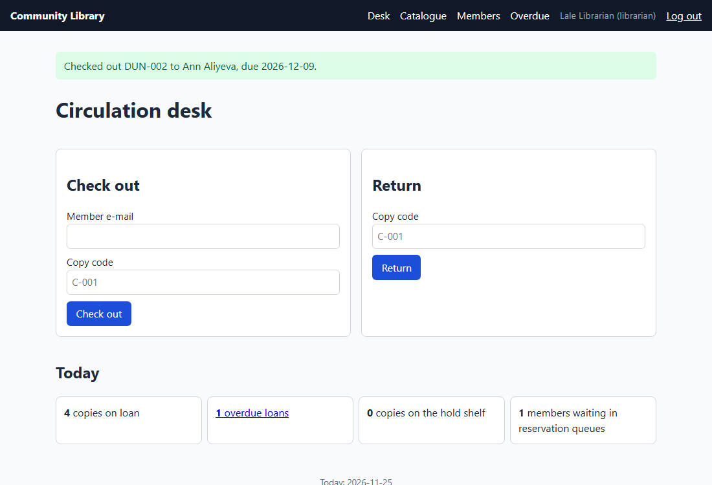

# Library Management System

Individual project for the Software Engineering course: a small web system for a community library that
manages titles, copies, members, loans, renewals, overdue fines and a reservation queue.

| | |
|---|---|
| **Student** | Ramil İmanov |
| **Group** | M666İ5 |
| **Topic** | Library Management System (Project Idea Pool #2) |
| **Deadline** | 02.12.2026 |



## Repository structure

| Folder / file | Contents |
|---|---|
| `docs/` | Requirements, models (PlantUML sources and images), test plan and report, traceability matrix, change request, code review, reflection |
| `src/library/` | Source code: `web/` (Flask pages), `services/` (business rules), `repositories/` (SQL), `schema.sql` |
| `tests/` | Automated tests: `unit/`, `integration/`, `system/` |
| `run_tests.py` | Runs all tests with coverage in one command |
| `.github/workflows/ci.yml` | Continuous integration (GitHub Actions) |

## Install

Requirements: **Python 3.12** or newer and Git. No database server is needed (SQLite is part of Python).

```bash
git clone https://github.com/imnvrml/library-management-system.git
cd library-management-system
python -m venv .venv
.venv\Scripts\activate            # Windows   (Linux/macOS: source .venv/bin/activate)
pip install -r requirements.txt
```

## Configure

All settings are optional environment variables:

| Variable | Default | Meaning |
|---|---|---|
| `LIBRARY_DB` | `instance/library.db` | Path of the SQLite database file (created automatically) |
| `LIBRARY_SECRET_KEY` | random at every start | Key that signs the session cookie. Without it, users are logged out when the server restarts — **set a long random value for real use** |

The business rules (loan period, limits, fines, pickup days) are in `src/library/rules.py`.

## Run

```bash
flask --app library seed-demo     # optional: demo titles, members and loans
flask --app library run           # open http://127.0.0.1:5000
```

Demo accounts (password `library123`): `librarian@library.local` (librarian), `ann@library.local`,
`ben@library.local`, `cem@library.local` (members).

To start with an empty library instead, create the first librarian account:

```bash
flask --app library create-librarian
```

## Test

```bash
python run_tests.py               # all tests + coverage report (htmlcov/index.html)
python run_tests.py -k CHK        # only the checkout test cases
```

Every test function carries the test case ID from `docs/test-plan.md` in its name (e.g.
`test_TC_CHK_03_loan_limit_reached`). The same command runs in GitHub Actions on every push and pull request.

## Documentation

| Deliverable | File |
|---|---|
| A. Requirements specification | `docs/requirements.md` |
| B. Analysis and design models | `docs/models.md`, diagrams in `docs/models/` |
| C. Test plan, test report, defect log | `docs/test-plan.md` |
| D. Traceability matrix | `docs/traceability.md` |
| Change request and impact analysis | `docs/change-request.md` |
| F. Process evidence | GitHub issues and project board, pull requests, `docs/code-review.md` |
| G. Reflection | `docs/reflection.md` |

PDF versions of all documents are in `docs/pdf/`. To regenerate the documents from the code:

```bash
python scripts/trace.py           # runs the tests, fills the test report results, rebuilds docs/traceability.md
pip install markdown              # only for the next command
python scripts/build_pdfs.py      # exports docs/*.md to docs/pdf/*.pdf (needs Google Chrome)
```

Diagrams are PlantUML sources in `docs/models/*.puml`; images are exported with
`java -jar plantuml.jar -tpng -o img docs/models/*.puml`.
