# Analysis and Design Models — Library Management System

| | |
|---|---|
| **Author** | Ramil İmanov (group M666İ5) |
| **Version** | 1.1 |
| **Date** | 2026-11-15 |
| **Based on** | Requirements Specification v1.1 |

**Revision history**

| Version | Change | Reason |
|---|---|---|
| 1.0 | First version. | — |
| 1.1 | Added `EligibilityPolicy` (pure functions `checkout_refusal`, `renew_refusal`, `reservation_refusal`, `payment_refusal`); SD-01, SD-03, SD-04 and SD-07 now call it. | Found while writing the test plan: the decision-table rules were hidden inside services that need a database, so they could only be tested at integration level. As pure functions they can be unit-tested exhaustively. |

All diagrams are written in PlantUML. The source files are in `docs/models/*.puml` and the exported images
in `docs/models/img/`. To regenerate the images: `java -jar plantuml.jar -tpng -o img docs/models/*.puml`.

## 1. Use case diagram

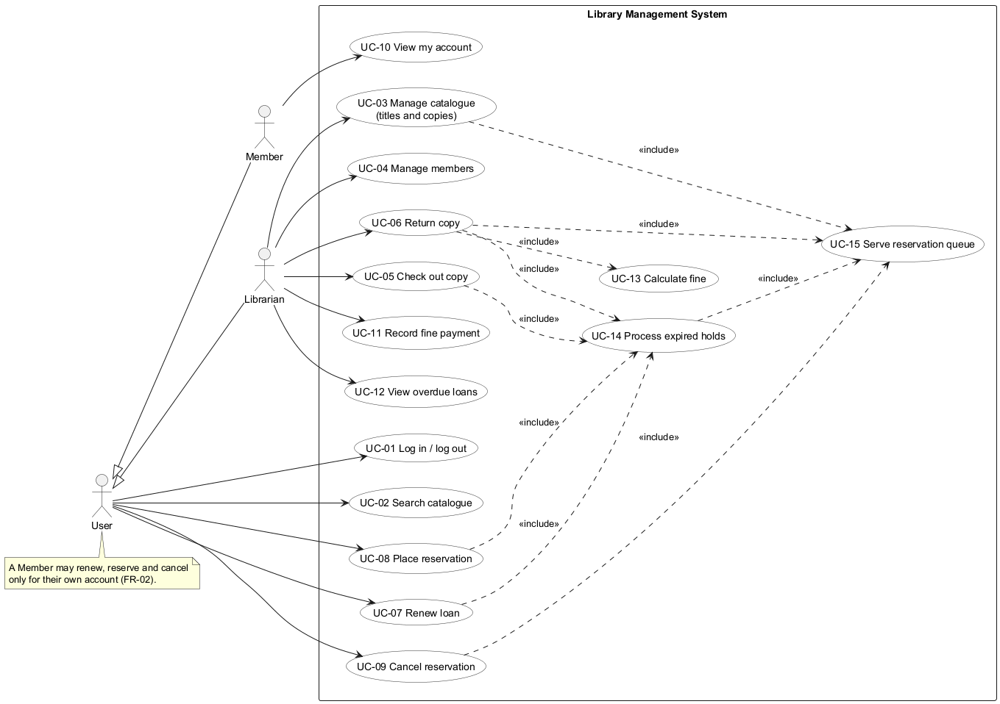

The diagram shows the 15 use cases and the two roles. The abstract actor *User* holds what both roles can do
(log in, search, renew, reserve, cancel); *Member* adds only the self-service account page, and *Librarian*
adds all desk and administration tasks. The `<<include>>` relations make visible that every circulation action
first processes expired holds (UC-14, design decision A-05) and that the reservation queue (UC-15) is served
from three places: return, new copy and cancelled hold.

### 1.1 Use case descriptions

#### UC-05 Check out copy
| Field | Content |
|---|---|
| **Actor** | Librarian |
| **Requirements** | FR-09, FR-14 AC2, FR-15, BR-01, BR-02, BR-05, BR-06, BR-09 |
| **Preconditions** | The librarian is logged in. The member and the copy exist in the system. |
| **Trigger** | A member brings a copy to the desk. |
| **Main flow** | 1. The librarian enters the member and the copy code. 2. The system processes expired holds (UC-14). 3. The system checks that the member is active, has fewer than 5 active loans, has no overdue loan and has a balance of at most 5.00 AZN. 4. The system checks that the copy is Available. 5. The system creates a loan with due date = today + 14 days and sets the copy to On loan. 6. The system shows the due date. |
| **Alternative flows** | **3a.** The member is inactive, has 5 loans, has an overdue loan or owes more than 5.00 AZN: the system shows the rule that failed; nothing is saved. **4a.** The copy is On hold for this member: the system continues at step 5 and sets the member's reservation to Fulfilled. **4b.** The copy is On hold for another member, On loan, Withdrawn or Lost: the system shows "Copy is held for another member" or "Copy is not available"; nothing is saved. |
| **Postconditions** | *Success:* one new open loan; the copy is On loan; a held reservation (4a) is Fulfilled. *Failure:* no data changed. |

#### UC-06 Return copy
| Field | Content |
|---|---|
| **Actor** | Librarian |
| **Requirements** | FR-10, FR-12, FR-14, FR-15, BR-07, BR-08 |
| **Preconditions** | The librarian is logged in. |
| **Trigger** | A member hands back a copy. |
| **Main flow** | 1. The librarian enters the copy code. 2. The system processes expired holds (UC-14). 3. The system finds the open loan of the copy. 4. The system calculates the fine (UC-13): 0.20 AZN per day after the due date, at most 10.00 AZN. 5. The system closes the loan with today's date and the fine. 6. The system serves the reservation queue (UC-15): there is no Waiting reservation, so the copy becomes Available. 7. The system shows the fine. |
| **Alternative flows** | **3a.** The copy has no open loan: the system shows "Copy is not on loan"; nothing is saved. **6a.** The title has a Waiting reservation: the copy becomes On hold for the oldest one, which becomes Ready for pickup with pickup deadline = today + 3 days; the system tells the librarian to put the copy on the hold shelf. |
| **Postconditions** | *Success:* the loan is closed with a fine ≥ 0; the copy is Available or On hold. *Failure:* no data changed. |

#### UC-07 Renew loan
| Field | Content |
|---|---|
| **Actors** | Member (own loans), Librarian (any loan) |
| **Requirements** | FR-11, FR-02 AC3, BR-01, BR-03, BR-04 |
| **Preconditions** | The actor is logged in. The loan is open. |
| **Trigger** | The actor clicks "Renew" next to a loan. |
| **Main flow** | 1. The actor selects the loan. 2. The system processes expired holds (UC-14). 3. The system checks that the loan belongs to the actor (Member only). 4. The system checks that the loan has been renewed fewer than 2 times, is not overdue, and that no other member has a Waiting reservation for the title. 5. The system sets due date = old due date + 14 days and increases the renewal count. 6. The system shows the new due date. |
| **Alternative flows** | **3a.** A member tries to renew another member's loan: the system answers HTTP 403. **4a.** The loan was renewed twice, is overdue, or the title is reserved by another member: the system shows the rule that failed; nothing is saved. |
| **Postconditions** | *Success:* due date +14 days, renewal count +1. *Failure:* no data changed. |

#### UC-08 Place reservation
| Field | Content |
|---|---|
| **Actors** | Member (for themselves), Librarian (on behalf of a member) |
| **Requirements** | FR-13, FR-15, BR-10, A-06 |
| **Preconditions** | The actor is logged in. The title exists. |
| **Trigger** | The actor clicks "Reserve" on a title that shows "0 of N available". |
| **Main flow** | 1. The actor selects the title. 2. The system processes expired holds (UC-14). 3. The system checks that the title has no Available copy, that the member has no active reservation for it, does not have it on loan and has fewer than 3 active reservations. 4. The system adds a Waiting reservation at the end of the title's queue. 5. The system shows the member's queue position. |
| **Alternative flows** | **3a.** A copy is Available: the system shows "A copy is available — borrow it at the desk". **3b.** The member already reserved the title or has it on loan: the system shows the matching message. **3c.** The member has 3 active reservations: the system shows "Reservation limit reached (3)". In all cases nothing is saved. |
| **Postconditions** | *Success:* one new Waiting reservation, last in the queue. *Failure:* no data changed. |

## 2. Domain model

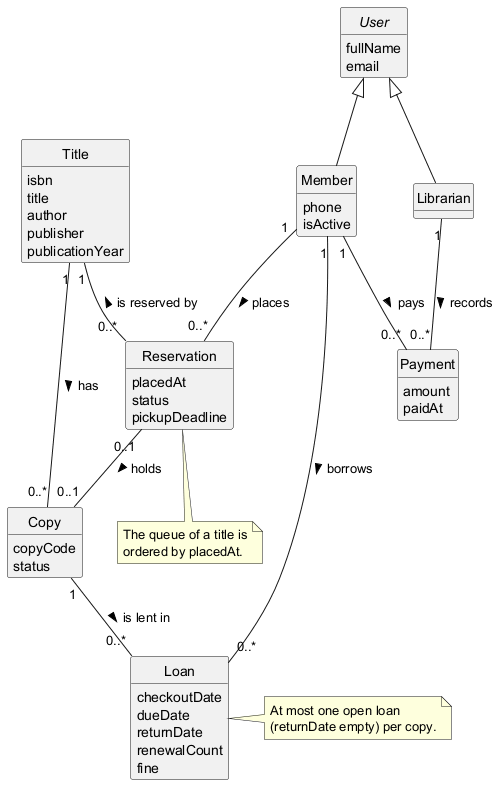

The conceptual classes and their associations without methods or types. It separates *Title* (the
bibliographic work) from *Copy* (the physical item), which is the decision that makes multiple copies, a
per-title reservation queue and per-copy loans possible. *Reservation* is attached to the title, not to a copy,
because a member wants *any* copy; the optional link to *Copy* exists only while a copy is held.

## 3. State machine diagrams

### 3.1 Copy (most important entity)

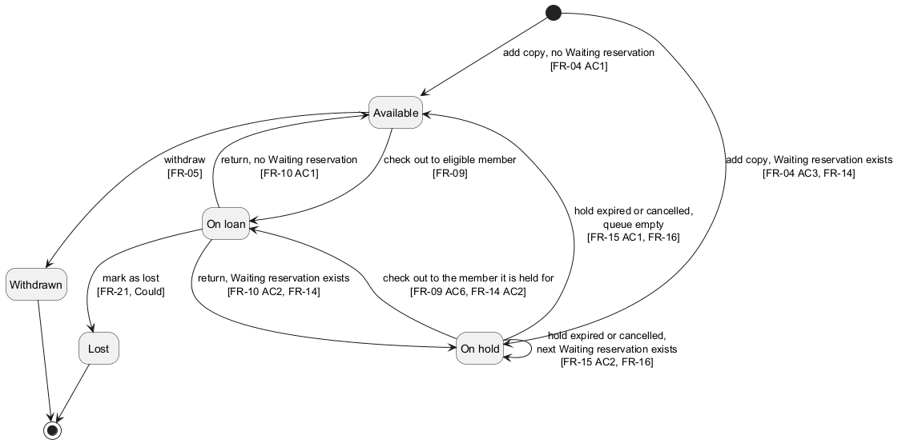

Every lending operation is a change of a copy's state, so the copy's life cycle is the core of the system.
Each transition is labelled with the requirement that causes it; the diagram supports the decision to store the
state explicitly in `copy.status` (Section 4.3) and shows that a returned or new copy goes to the queue
before it becomes Available.

### 3.2 Reservation (supporting)

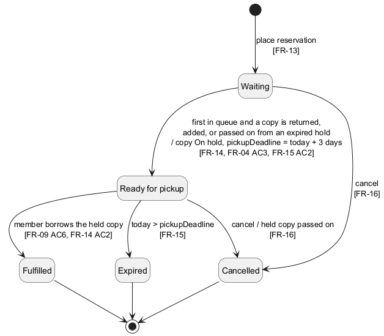

The reservation life cycle drives FR-13 to FR-16. It shows that only *Ready for pickup* has a deadline and that
three end states exist, which the test plan uses for state transition testing.

## 4. Entity-relationship diagrams

### 4.1 Conceptual ERD

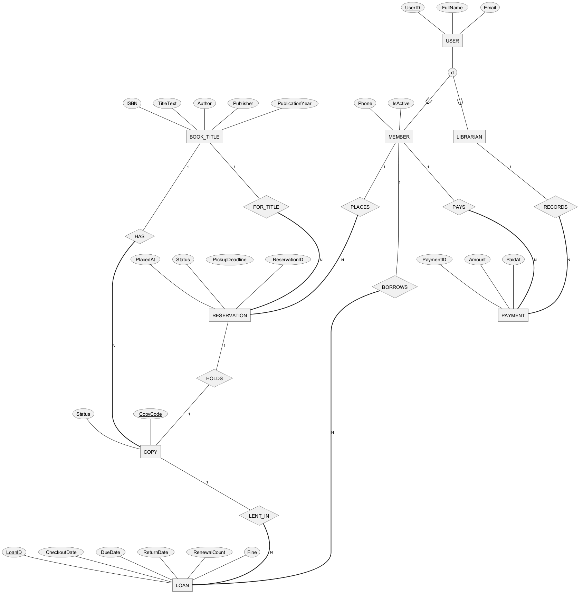

Chen notation with entities, key attributes and relationship cardinalities. A double line means total
participation (for example, every loan must belong to exactly one member and one copy). The disjoint
specialisation of USER into MEMBER and LIBRARIAN mirrors the two roles.

### 4.2 Logical ERD

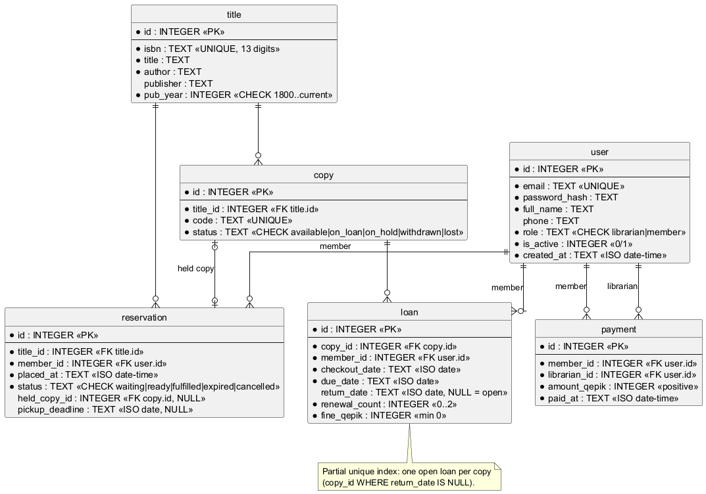

The six SQLite tables with primary keys, foreign keys, types and constraints. The specialisation of USER is
mapped to **one table with a `role` column** (single-table inheritance) because the two roles share almost all
attributes and a librarian has no extra data. Money columns are integers in qəpik (BR-14). A partial unique
index guarantees at most one open loan per copy.

### 4.3 Normalisation to 3NF

| Table | Key | Functional dependencies | Normal form |
|---|---|---|---|
| user | id (also email) | id → email, password_hash, full_name, phone, role, is_active, created_at | 3NF |
| title | id (also isbn) | id → isbn, title, author, publisher, pub_year | 3NF |
| copy | id (also code) | id → title_id, code, status | 3NF |
| loan | id | id → copy_id, member_id, checkout_date, due_date, return_date, renewal_count, fine_qepik | 3NF |
| reservation | id | id → title_id, member_id, placed_at, status, held_copy_id, pickup_deadline | 3NF |
| payment | id | id → member_id, librarian_id, amount_qepik, paid_at | 3NF |

- **1NF:** all values are atomic. `author` is stored as one text value (e.g. "Terry Pratchett; Neil Gaiman") because the system only displays it and searches it by substring; it never selects or counts single authors. If per-author features are added later, an `author` table and a `title_author` link table would be introduced.
- **2NF:** every table has a single-column surrogate key, so no partial dependencies exist.
- **3NF:** no non-key attribute depends on another non-key attribute. Title data is not repeated in `copy`, and member data is not repeated in `loan` or `reservation`.
- **Derived values are not stored:** the member's balance (sum of fines − sum of payments), the number of available copies and a member's queue position are calculated by queries.

**Justified denormalisation — `copy.status`.** The states *On loan* and *On hold* could be derived from an
open loan or a Ready reservation, so storing them duplicates information. It is kept because (1) *Withdrawn* and
*Lost* cannot be derived from other tables, so the column is needed anyway; (2) the state machine in Section 3.1
maps one-to-one onto this column, which makes the rules and tests easier to read; (3) search can count
available copies with a simple `WHERE status = 'available'`. The risk of inconsistency is controlled by changing
`copy.status` only inside the same transaction as the related loan or reservation (NFR-04) and by integration
tests that check both tables after each operation.

**Stored fine — `loan.fine_qepik`.** The fine could be recomputed from the dates, but the business rules
(BR-07) may change in the future; a charged fine must not change afterwards, so it is stored at return time.
This is a historical fact, not a duplicate.

## 5. Design class diagrams

### 5.1 Presentation and business-logic layers

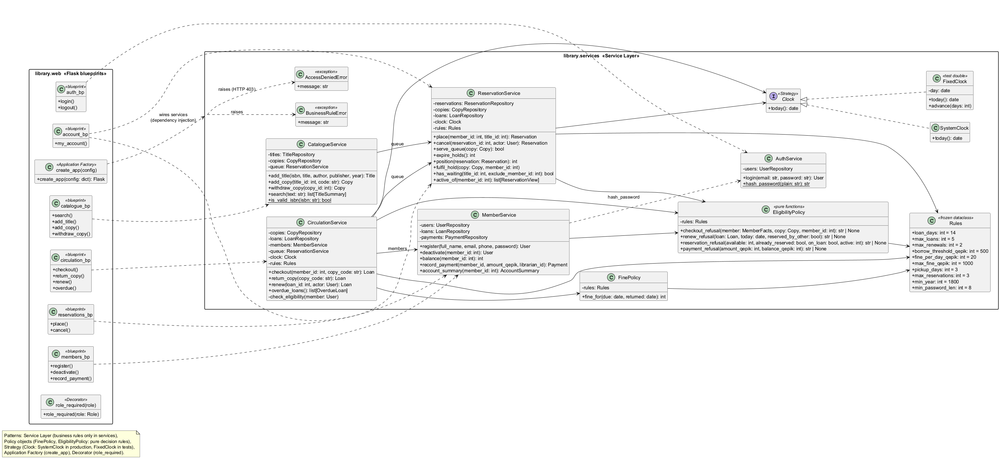

Flask blueprints only translate HTTP requests into service calls; all business rules live in the services.
Patterns marked: **Service Layer** (services), **Policy objects** (`FinePolicy` and `EligibilityPolicy` hold the
decision rules as pure functions without database access, so every decision-table rule is unit-testable),
**Strategy** (`Clock` with `SystemClock` and the test double
`FixedClock`, needed to test date boundaries, A-10), **Application Factory** (`create_app`, which wires the
services through constructor injection), and **Decorator** (`role_required`, FR-02). Rule values live in one
frozen `Rules` object (Section 7 of the requirements).

### 5.2 Data-access layer and domain objects

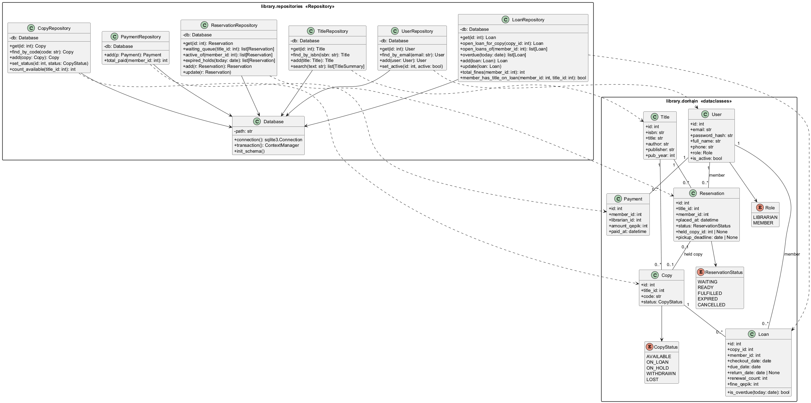

The **Repository** pattern hides all SQL behind one class per table, so services work with plain dataclasses.
`Database.transaction()` is a context manager that commits or rolls back, which is how NFR-04 (atomic
operations) is implemented.

## 6. Sequence diagrams

| ID | Scenario | Use cases covered | Error / alternative path |
|---|---|---|---|
| SD-01 | Check out a copy | UC-05, UC-14 | Yes: any failed rule → rollback and message |
| SD-02 | Return a copy | UC-06, UC-13, UC-14, UC-15 | Yes: copy not on loan; queue empty vs not empty |
| SD-03 | Renew a loan | UC-07, UC-14 | Yes: 403 for another member's loan; rule failures |
| SD-04 | Place and cancel a reservation | UC-08, UC-09, UC-14, UC-15 | Yes: rule failures; 403; held copy passed on |
| SD-05 | Log in, view account, access control | UC-01, UC-10 | Yes: wrong password; deactivated; 403 |
| SD-06 | Add title and copy, search | UC-02, UC-03, UC-15 | Yes: invalid/duplicate ISBN; duplicate copy code |
| SD-07 | Register/deactivate member, payment, overdue list | UC-04, UC-11, UC-12 | Yes: duplicate e-mail; invalid amount |

### SD-01 Check out a copy
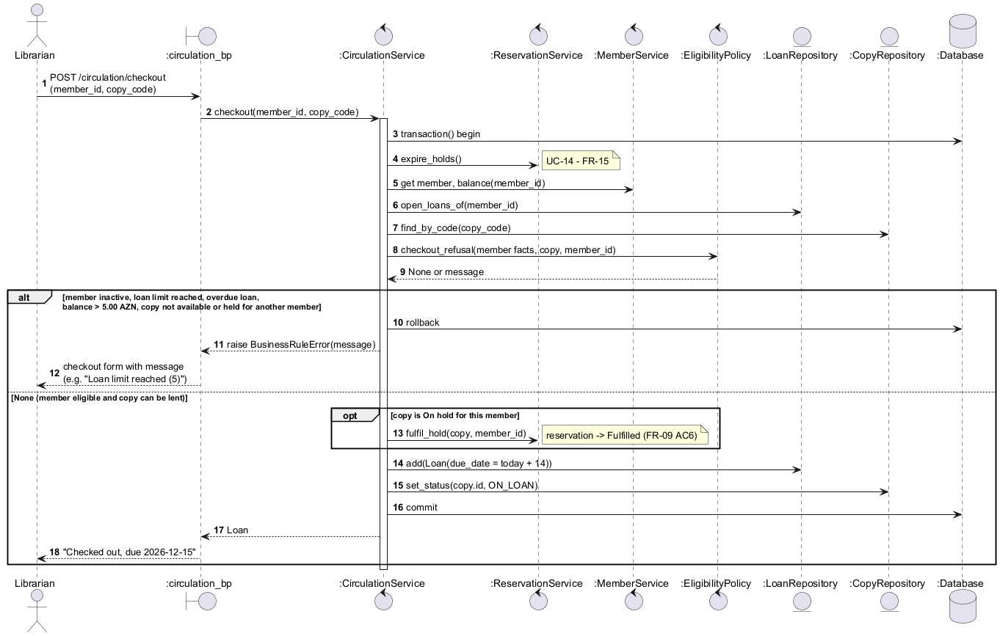

Shows the most important scenario, including the error path: all eligibility checks happen inside one
transaction, and any failed rule rolls it back and returns the rule's message. This supports the decision that
services raise `BusinessRuleError` and blueprints only display it.

### SD-02 Return a copy
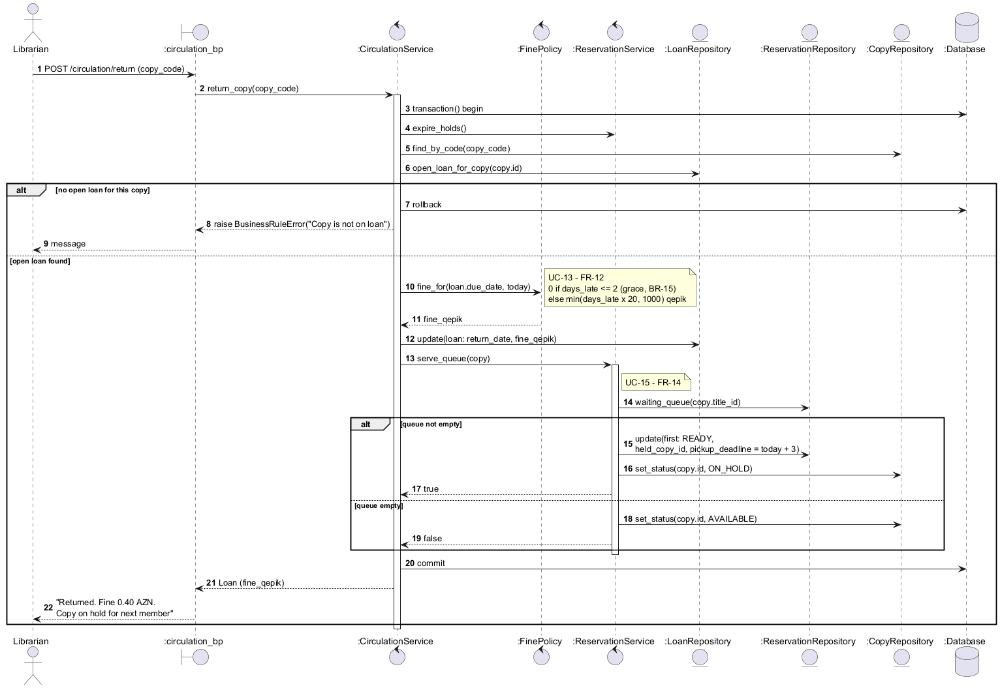

Shows how one return triggers three included use cases (expire holds, calculate fine, serve queue) and the
two outcomes for the copy. It supports keeping the queue logic in `ReservationService` so that return, new
copy and cancellation reuse it.

### SD-03 Renew a loan
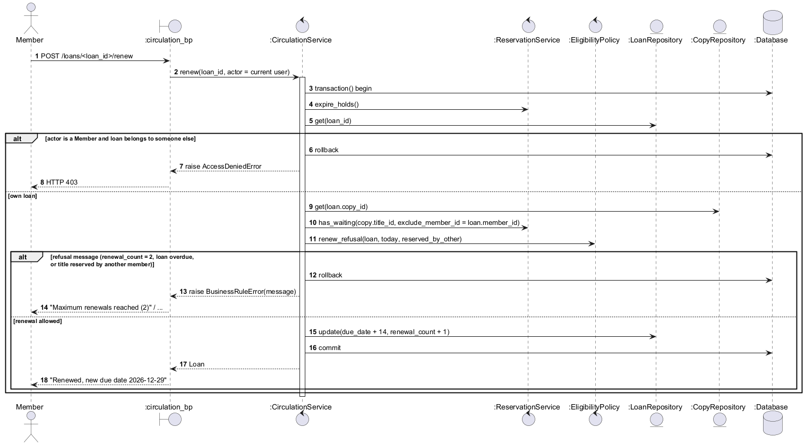

Shows the ownership check (HTTP 403) before the business checks, which supports FR-02 AC3, and the three
rules that can refuse a renewal.

### SD-04 Place and cancel a reservation
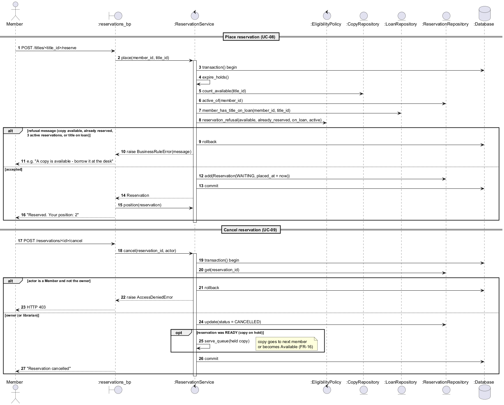

Shows the four acceptance checks of a reservation and how cancelling a Ready reservation passes the held copy
on, which is why `cancel` calls `serve_queue`.

### SD-05 Log in, view account, access control
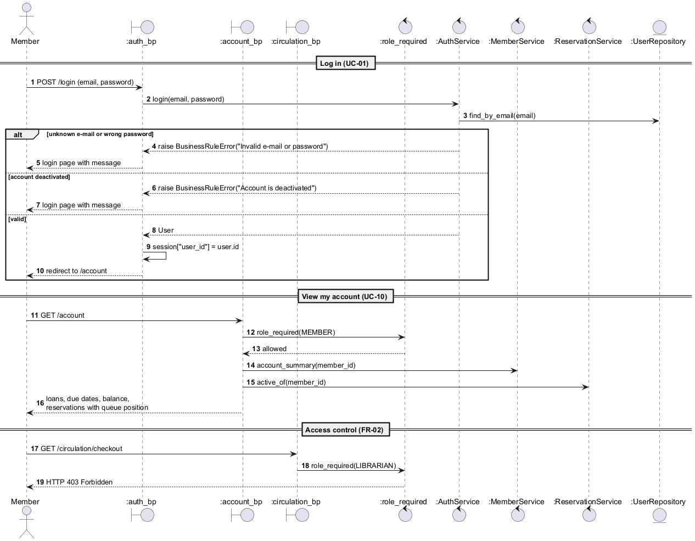

Shows that login uses one message for unknown e-mail and wrong password (FR-01 AC2), and that the
`role_required` decorator rejects a member on a librarian page before any service is called.

### SD-06 Manage catalogue and search
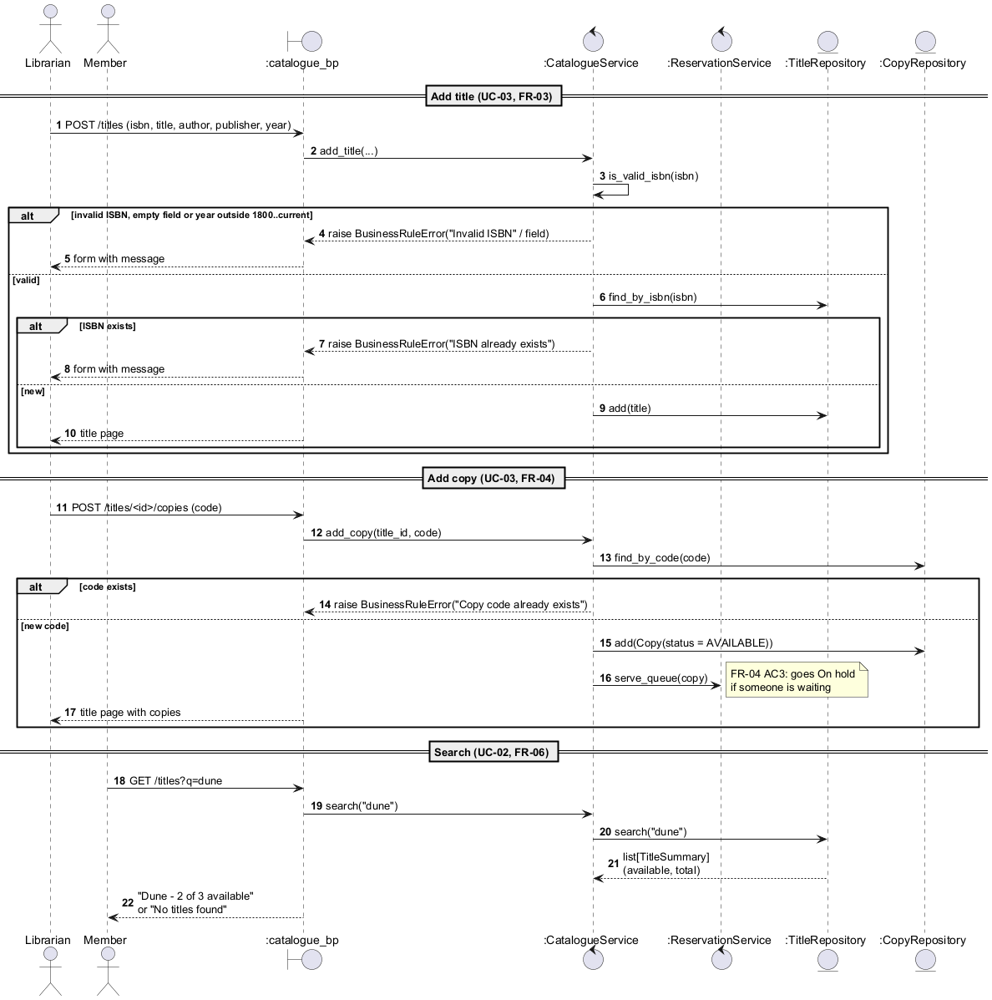

Shows ISBN validation before the duplicate check and that a new copy is offered to the reservation queue
(FR-04 AC3, the requirement added in v1.1).

### SD-07 Manage members, payments and overdue list
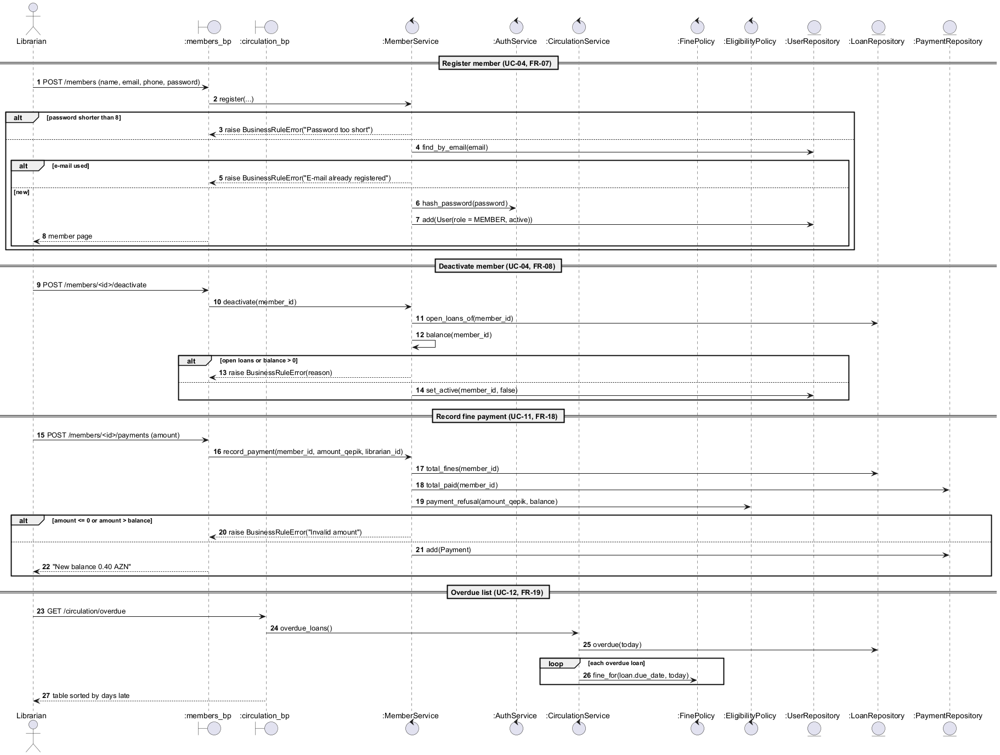

Shows that the balance is always calculated (fines − payments) and never stored, and that the overdue list
calculates the fine accrued so far with the same `FinePolicy` used at return.

## 7. Architecture overview

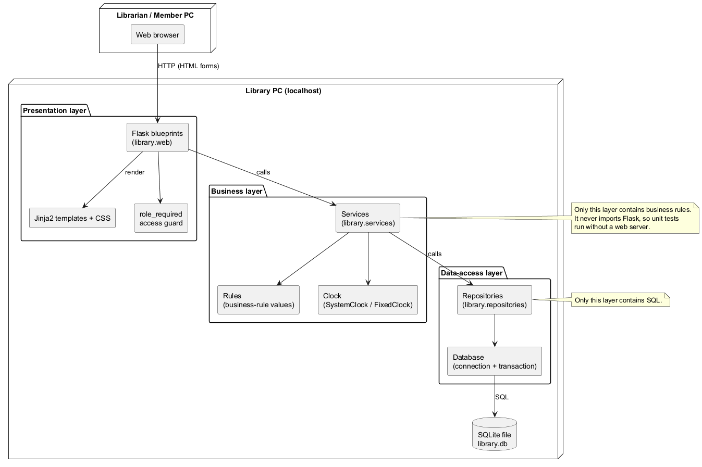

A three-layer architecture on one computer: presentation (Flask, Jinja), business (services) and data access
(repositories, SQLite). Each layer only calls the layer below it. Keeping Flask out of the business layer lets
the unit tests check every business rule without a web server, and keeping SQL in the repositories means a
different database would only change one layer.

## 8. Consistency checks

### 8.1 Every use case appears in a sequence diagram

| Use case | Sequence diagram |
|---|---|
| UC-01 Log in / log out | SD-05 |
| UC-02 Search catalogue | SD-06 |
| UC-03 Manage catalogue | SD-06 |
| UC-04 Manage members | SD-07 |
| UC-05 Check out copy | SD-01 |
| UC-06 Return copy | SD-02 |
| UC-07 Renew loan | SD-03 |
| UC-08 Place reservation | SD-04 |
| UC-09 Cancel reservation | SD-04 |
| UC-10 View my account | SD-05 |
| UC-11 Record fine payment | SD-07 |
| UC-12 View overdue loans | SD-07 |
| UC-13 Calculate fine | SD-02, SD-07 |
| UC-14 Process expired holds | SD-01, SD-02, SD-03, SD-04 |
| UC-15 Serve reservation queue | SD-02, SD-04, SD-06 |

### 8.2 Every ERD entity corresponds to a domain concept

| Logical table | Conceptual entity | Domain class | Design class |
|---|---|---|---|
| user | USER, MEMBER, LIBRARIAN | User, Member, Librarian | User (+ Role) |
| title | BOOK_TITLE | Title | Title |
| copy | COPY | Copy | Copy (+ CopyStatus) |
| loan | LOAN | Loan | Loan |
| reservation | RESERVATION | Reservation | Reservation (+ ReservationStatus) |
| payment | PAYMENT | Payment | Payment |

### 8.3 Every state transition corresponds to a requirement

| Entity | From → To | Requirement |
|---|---|---|
| Copy | (new) → Available | FR-04 AC1 |
| Copy | (new) → On hold | FR-04 AC3, FR-14 |
| Copy | Available → On loan | FR-09 |
| Copy | On loan → Available | FR-10 AC1 |
| Copy | On loan → On hold | FR-10 AC2, FR-14 |
| Copy | On hold → On loan | FR-09 AC6, FR-14 AC2 |
| Copy | On hold → On hold (next member) | FR-15 AC2, FR-16 |
| Copy | On hold → Available | FR-15 AC1, FR-16 |
| Copy | Available → Withdrawn | FR-05 |
| Copy | On loan → Lost | FR-21 (Could) |
| Reservation | (new) → Waiting | FR-13 |
| Reservation | Waiting → Ready for pickup | FR-14, FR-04 AC3, FR-15 AC2 |
| Reservation | Ready for pickup → Fulfilled | FR-09 AC6, FR-14 AC2 |
| Reservation | Ready for pickup → Expired | FR-15 |
| Reservation | Waiting / Ready for pickup → Cancelled | FR-16 |

### 8.4 Requirements without a use case
FR-20 (statistics) and FR-21 (lost copy) are *Could* extensions; they are specified but not modelled as use cases
or implemented in this release. FR-21 is still shown in the Copy state machine because it defines the *Lost* state.
